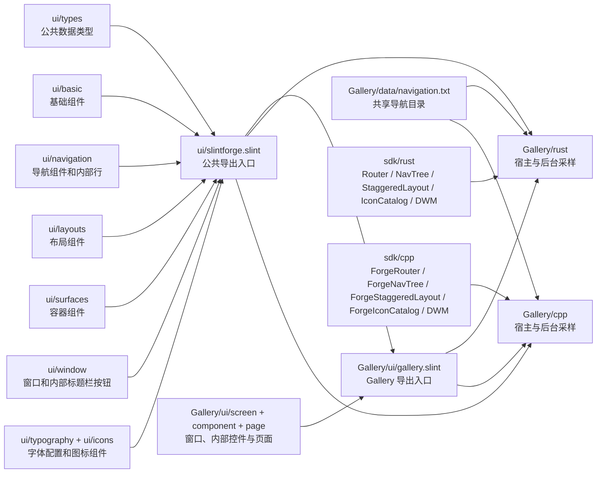

# 架构与生命周期

## 分层

公共组件发送用户意图，宿主验证路由或导航树变更后，通过属性回写新状态。Rust 与 C++ 对同一 `.slint` 文件分别编译。需要计算或导出的组件通过共享服务契约接到两端 SDK；专业图表和节点编辑分别使用 `sdk/common/ForgePlotCore.cpp`、`ForgeFlowCore.cpp`。C++ SDK 直接链接核心，Rust 接口调用已有运行库 DLL；只有运行库研发构建通过 `cc` 编译共用核心，外部 Rust SDK 使用已构建 DLL。

ForgeFlow 在 `ui/flow/` 实现画布、节点容器、端口、控制条和小地图，`ui/types/flow.slint` 定义共享模型和服务。每个画布持有独立文档句柄；控制器维护稳定 ID、100 步历史、连接校验、连线几何、树布局和版本化 JSON。连续拖动使用事务，节点模型按行通知，视口平移不进入编辑历史；几何只更新与移动节点关联的连线。调用方持有自定义节点循环，在 `ForgeFlowNode.@children` 中组合业务控件。详见 [ForgeFlow](FLOW.md)。

`ui/slintforge.slint` 只汇总公共导出。公共类型放在 `ui/types/`，基础组件放在 `ui/basic/`，导航组件放在 `ui/navigation/`，布局组件放在 `ui/layouts/`，容器组件放在 `ui/surfaces/`，窗口组件放在 `ui/window/`，文字字体配置放在 `ui/typography/`，图标组件放在 `ui/icons/`，每个组件各占一个文件。`ui/navigation/internal/` 与 `ui/window/internal/` 中的辅助组件不从 `@slintforge` 导出。固定上游字体 JSON 经 `ui/icons/sync_catalog.py` 生成 9,767 项目录，Rust/C++ SDK 从同一目录提供名称查询；Gallery 搜索分页浏览。C++ 安装包递归安装依赖的 `.slint`、图标字体、目录、码位表及许可文件。新增组件先按类别增加实现文件，再显式加入公共入口。

## 导航与页面

导航树由宿主校验。侧栏接收按展开状态扁平化的 `items`，按深度缩进，并通过 `group-toggle-requested` 交由宿主更新展开状态。顶部导航接收完整的 `tree-items`：顶栏只绘制一级入口，子项通过按 `parent-id` 分组的下拉菜单逐级打开，右侧“更多”入口覆盖被顶栏裁切的分类。顶部菜单不依赖侧栏展开状态。按 ID 导航成功后，宿主展开当前页的祖先分组；`hidden` 状态保留窗口标题栏中的菜单按钮，以便重新展开。

Gallery 按 `screen/`、`component/`、`page/` 分层，`Gallery/ui/gallery.slint` 导出窗口与截图服务契约。主窗口继承 `ForgeWindow`，其 `@children` 内放置导航及固定页面区域；导航组件在这里关闭自己的应用顶栏。`Gallery/data/navigation.txt` 保存分类树、页面 ID、导航区与页脚区；Rust 直接编入该文件，C++ 在 CMake 配置时生成嵌入头文件。全部已注册页面在 `Gallery/ui/screen/main-screen.slint` 的固定内容区域常驻，切换路由更新 `visible`，包括原生组件、共享组件、基础图表、ForgePlot、DataGrid 和 TreeDataGrid。新增页面需要更新目录和 `.slint` 页面注册后重新编译。

Gallery 的 `@tr` 字符串由 Slint 编译进 Rust/C++ 两端，中文是源语言，英语译文从 `Gallery/i18n/en.tsv` 生成两份 PO 文件。宿主负责选择译文，并用本地语言重建导航标题；用户设置保存在同一份 `%APPDATA%\SlintForge\Gallery\settings.ini` 中。`ForgeTypography` 是共享文字字体与字号状态；图标字体由 `ForgeIcon` 从组件库资源加载，文字字体选择不覆盖图标字体。窗口置顶状态映射到 `ForgeWindow.pinned`；圆角设置映射到 `rounded-corners`，Windows 宿主通过 DWM 边角偏好应用。标题栏和设置页变更都由宿主保存并回写。原创 Gallery PNG 用于 Slint 标题栏及任务栏，ICO 同时嵌入两端 Windows 可执行文件。

生命周期页的输入控件归该页实例所有。两个宿主各自运行独立采样线程；无论生命周期页是否显示，线程都会每 100 ms 增加采样计数。UI 定时器只读取当前计数，隐藏页停止绘制，返回后显示最新值。真实采集应用可用自己的持续运行数据源替换该演示线程。

## 边界

瀑布流的源数据与布局结果分层：Rust/C++ SDK 按相同最短列算法计算稳定 ID 的列号和纵向位置，公共 Slint 组件绘制纯色卡片，并在列数变化时要求宿主重排。自动列宽和滚动条预留空间由公共组件统一决定。通用虚拟网格暂缓；Gallery 主页面和设置页继续使用既有页面结构，`ForgePageStack`、`ForgeFormRow` 在各自示例页验证。

- v0.1.1 已提供文件树、DataGrid、TreeDataGrid、基础图表及专业二维图表 ForgePlot；暂未提供通用 PropertyGrid 或无限规模虚拟化表格。
- 不提供运行时加载外部 `.slint` 并嵌入现有窗口的双语言 API。
- 导航 ID 在应用注册表内稳定；路由参数是小型有序键值列表，比较时包括键、值和顺序。
- UI 线程处理 Slint 属性和回调；后台线程不直接访问窗口对象。

截图服务契约位于共享 Slint 类型层。窗口和页面调用所属顶层实例的服务，Rust/C++ SDK 以弱引用接到 Slint 渲染器快照，再按逻辑矩形和缩放系数裁剪。截图保持当前画面状态；PNG 编码由各宿主调用共享 SDK 接口。

服务绑定、模型原位修改后的刷新、后台线程回传以及性能适用条件统一见 [接入约定](INTEGRATION.md)。Rust 所有示例进入根工作区并使用同一 Cargo.lock；内部交付使用保留目录依赖的源码 SDK ZIP 和双配置 C++ 安装包，见 [交付说明](RELEASE.md)。
